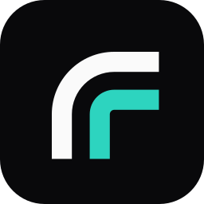
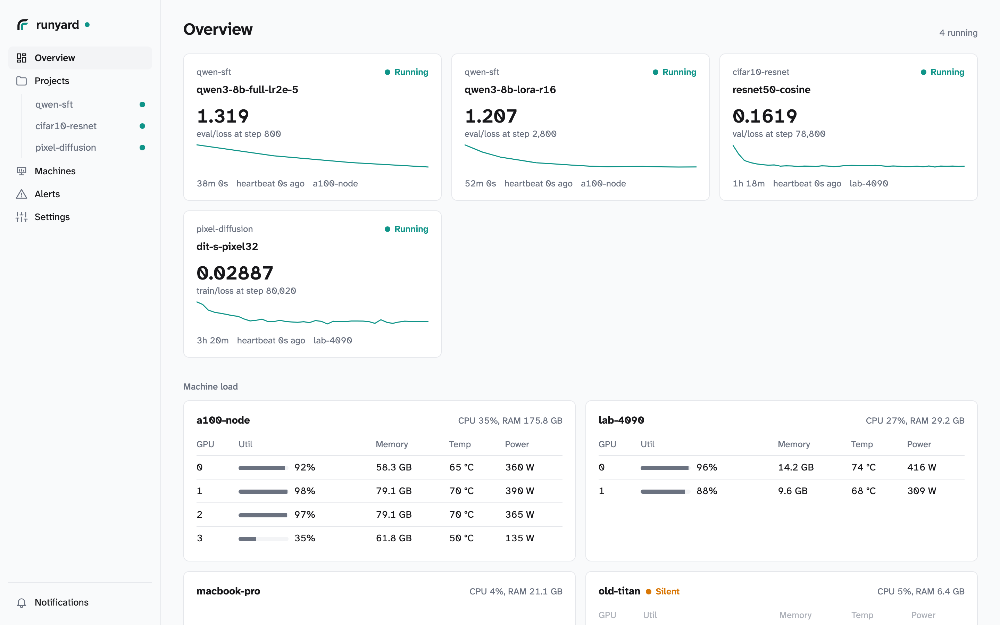

<p align="center">
  
</p>

<h1 align="center">runyard</h1>

<p align="center">
  <strong>Your training runs, live, on your own machines.</strong><br>
  A self-hosted tracker for ML runs: one Go binary and PostgreSQL, a web UI, iPhone and Android apps, and an MCP server for your agents.
</p>

<p align="center">
  <a href="#try-it"><strong>Get started</strong></a> ·
  <a href="https://runyard.cobanov.dev/demo/">Live demo</a> ·
  <a href="https://cobanov.github.io/runyard/">Docs</a> ·
  <a href="https://runyard.cobanov.dev">Website</a> ·
  <a href="https://pypi.org/project/runyard/">PyPI</a> ·
  <a href="https://testflight.apple.com/join/A9jhtURf">iPhone beta</a> ·
  <a href="https://github.com/cobanov/runyard/releases/download/v0.7.0/runyard-0.5.0.apk">Android APK</a> ·
  <a href="https://github.com/cobanov/runyard/issues">Issues</a>
</p>

runyard is for anyone who trains models on their own GPUs and wants to see how a run is going without a cloud
account. Three lines of Python send a run's metrics, samples, logs and checkpoints to a server you run. The web UI
and the iPhone app show them live, your phone hears when a run finishes, fails or goes silent, and your coding
agents read all of it over MCP. Far fewer features than W&B or MLflow, on purpose.

<p align="center">
  <picture>
    <source media="(prefers-color-scheme: dark)" srcset="www/img/overview-dark.png">
    
  </picture>
  <br><sub>The Overview: what is training, how each machine's GPUs are doing, and what just ended.</sub>
</p>

## A yard for your training runs

- **Three lines to log.** `ry.init`, then `run.log` every few steps. Images, videos, text tables, alerts and
  checkpoints too. Calls go out from a background thread and wait out a server restart, so the library never stops
  training.
- **No code change for the tools you already use.** Hugging Face Trainer and TRL, Accelerate, Lightning, Keras,
  XGBoost, LightGBM, scikit-learn and torchtune with one line; anything that speaks Weights & Biases, TensorBoard or
  MLflow with none.
- **Honest states.** A clean exit is finished, an exception is failed, five minutes without a heartbeat is crashed,
  and "no progress" means the process is alive but the loop stopped logging.
- **Live on every screen.** A phone-first web UI with charts, samples, logs, config diffs and run comparison, and a
  native iPhone app that shows each running run's loss, progress, time left and the machine's GPUs at a glance.
- **Your machines too.** `runyard beacon` on each box shows its GPUs, every process on them (whoever started it), CPU,
  memory and disk, training or not, and the server tells you when a machine goes silent.
- **It tells you.** ntfy, Slack, Discord, Telegram, a webhook or web push when a run ends, and checks that raise
  alerts from the data: a NaN loss, a crossed threshold, a stuck run.
- **Your agents read it.** An MCP server at `/mcp` and a `--json` CLI: list runs, read curves, look at the samples,
  tail the logs, compare runs, leave a verdict. [SKILL.md](SKILL.md) teaches an agent the routine. A run an agent
  starts lands on that agent's card, with its report and the project's best score, and `/#/kiosk` puts the cards
  on a TV. [Coding agents](docs/agents.md)
- **Yours.** Docker Compose with PostgreSQL, media on disk or in an S3 or R2 bucket, optional users and teams. API
  keys, notification channels and deleting old runs are on the Settings page.

## Try it

From nothing to a first tracked run, in about five minutes.

**1. Start the server** (Docker, on the machine that will keep your runs):

```sh
curl -O https://raw.githubusercontent.com/cobanov/runyard/main/docker-compose.yml
docker compose up -d                                             # http://localhost:8080
```

Open it and go to Settings: a fresh server offers to make its first API key (`ry_...`) and fills it into the
commands below. From a shell, `docker compose exec app /runyard-server key create my-laptop` does the same.

**2. On the machine that trains**, install the library and say where the server is. Nothing else is configured
anywhere; these two settings are all a script, a framework integration or the W&B bridge needs:

```sh
pip install "runyard[images,system]"
export RUNYARD_SERVER=http://localhost:8080 RUNYARD_API_KEY=ry_...
```

**3. Log.** In your own loop:

```python
import runyard as ry

run = ry.init(project="my-project", name="lr3e-4", config={"lr": 3e-4})
run.log({"loss": loss.item()}, step=step)
run.image("samples", grid, step=step)
```

or without touching the code, when it already logs to Weights & Biases. With no `wandb` package installed,
`import wandb` is runyard's bridge, so step 2 is the whole change (and a trainer that resumes its W&B run by id
resumes its runyard run):

| Tool | What turns its logging on |
|---|---|
| [ai-toolkit](https://github.com/ostris/ai-toolkit) | `logging: { use_wandb: true }` in the job's YAML |
| kohya-ss sd-scripts | `--log_with wandb` |
| transformers `Trainer`, TRL | `report_to="wandb"` |
| diffusers example scripts | `--report_to wandb` |
| your own script | `import runyard.wandb as wandb` |
| a tool that logs nowhere | `runyard run --samples out/ -- python train.py`: output, exit status, GPU, and new images as samples |

**4. Open `http://localhost:8080`.** The run is there, live: charts, samples, output, config, the command line
and the machine it runs on. Settings has a QR code that connects the phone app to the same server.

A run never waits for the server: calls are queued, and what could not be sent is kept on disk and sent by the
next run. [Log runs](docs/logging.md) has every integration, and [Run the server](docs/server.md) covers the
address, storage, users and teams, backups and upgrades.

**Give it to your agent.** Add the MCP server, or hand the agent one link,
`https://raw.githubusercontent.com/cobanov/runyard/main/SKILL.md`, and ask how the run is going:

```sh
claude mcp add --transport http runyard http://localhost:8080/mcp --header "Authorization: Bearer $RUNYARD_API_KEY"
```

**On the phone.** The web UI installs to the home screen and sends push notifications. The native apps connect
to your server by its address, and both have "Try the demo" for a look without one: iPhone through the
[TestFlight beta](https://testflight.apple.com/join/A9jhtURf) ([ios/](ios/README.md)), Android as an [APK](https://github.com/cobanov/runyard/releases/download/v0.7.0/runyard-0.5.0.apk) ([android/](android/README.md)).

## Want to tinker?

A Go server (net/http, pgx, the MCP Go SDK) with the Svelte 5 web UI embedded in its binary, a Python library with
no required dependencies, a SwiftUI app and a Compose Android app. `make server` builds it, `make test` runs the Go and Python tests
against a PostgreSQL in Docker, and `docker compose up -d --build` runs your checkout instead of the release.

[Run the server](docs/server.md) ·
[Log runs](docs/logging.md) ·
[Read runs](docs/reading.md) ·
[Notifications and checks](docs/notifications.md) ·
[iPhone app](ios/README.md) ·
[Android app](android/README.md) ·
[Design](DESIGN.md) ·
[For agents](SKILL.md) ·
[llms.txt](docs/llms.txt)

| Path | What |
|---|---|
| `server/` | Go server: REST API, SSE, MCP, notifications, the embedded web UI |
| `web/` | Svelte + Vite web UI (built into `server/webdist/dist`) |
| `sdk/python/` | Python library, CLI and framework integrations |
| `ios/` | SwiftUI iPhone app (an XcodeGen project) |
| `android/` | Kotlin and Compose Android app |
| `www/` | the website at runyard.cobanov.dev; `web/demo/` builds its live demo |

---

[Apache-2.0](LICENSE) · Atkinson Hyperlegible Next and Mono under the [SIL Open Font License](https://github.com/googlefonts/atkinson-hyperlegible-next)
